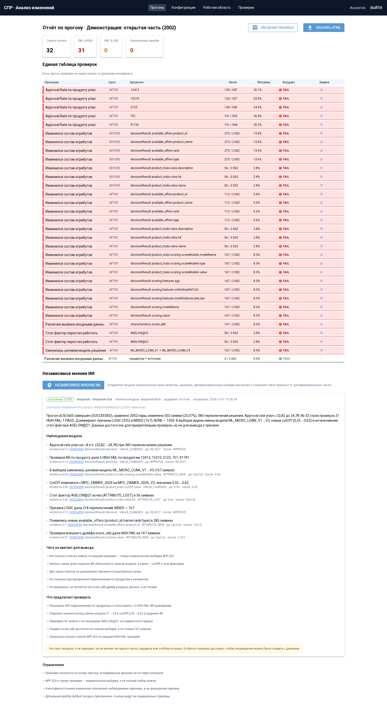
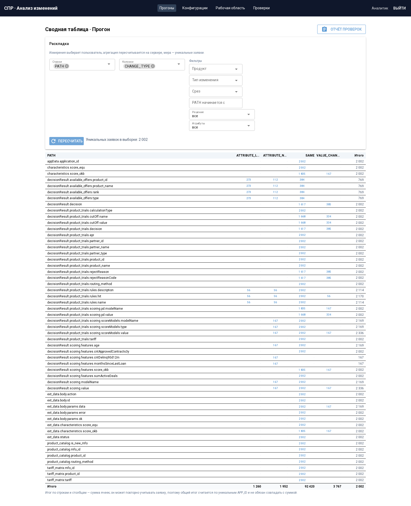
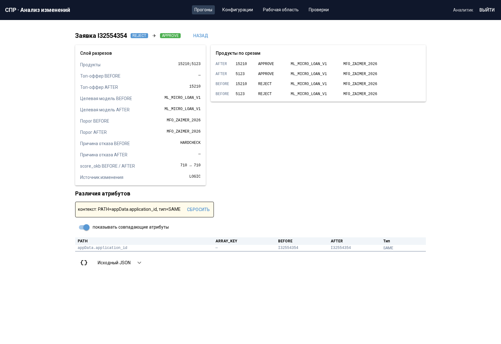
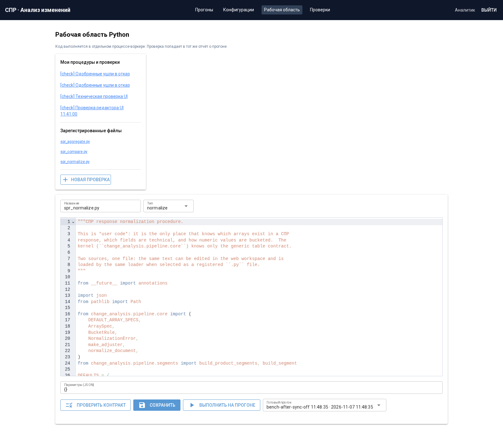

# СПР · Система анализа изменений

| | |
|---|---|
| **Проект** | Система анализа изменений СПР (модули 3 и 4 учебного задания) |
| **Команда** | `{{НАЗВАНИЕ КОМАНДЫ}}` |
| **Задача** | Превратить два среза ответов СПР (`BEFORE` = MASTER, `AFTER` = BETA) в витрину различий и отчёт, по которому аналитик за минуту понимает: что изменилось, у кого и из-за чего |
| **Участники** | `{{ФИО 1}}`, `{{ФИО 2}}`, `{{ФИО 3}}` |
| **Репозиторий** | https://github.com/Mixenix/nuclearIThack-decision-analysis-system |

> Всё, что ниже, проверено запуском на этой машине; где что-то не проверялось — это
> написано прямо, без «всё готово».


Приложение для модулей 3 и 4 задачи «Система анализа изменений»: превращает два среза
ответов СПР (`BEFORE` = MASTER и `AFTER` = BETA) в витрину различий и отчёт, по
которому аналитик за минуту понимает, что изменилось, у кого и из-за чего.

Многопользовательское, на NiceGUI + PostgreSQL + отдельный Python-воркер. Без Docker.

> **Перед демонстрацией:** [`docs/КАК_ЗАПУСТИТЬ.md`](docs/КАК_ЗАПУСТИТЬ.md) — три команды
> до работающего приложения, девять шагов показа с ожидаемыми числами и таблица
> «если что-то пошло не так».

> **Для разработчиков:** как поднять, где точки расширения и что нельзя ломать —
> [`CONTRIBUTING.md`](CONTRIBUTING.md). Список честных ограничений и кандидатов на
> улучшение — [`docs/IMPROVEMENTS.md`](docs/IMPROVEMENTS.md).

---

## Что где смотреть (по требованиям к README)

| Требование организаторов | Раздел |
|---|---|
| 1. Описание решения, основная идея и функционал | [§1](#1-что-оно-делает-и-чего-не-делает) и [«Результат в цифрах»](#результат-в-цифрах) |
| 2. Структура репозитория | [§9](#9-структура) |
| 3. Используемые технологии | [§2a](#2a-используемые-технологии) |
| 4. Данные: источники и предобработка | [§2b](#2b-данные) |
| 5. Архитектура и подход | [§1](#1-что-оно-делает-и-чего-не-делает), [`docs/ARCHITECTURE_NOTE.md`](docs/ARCHITECTURE_NOTE.md), [`docs/DECISIONS.md`](docs/DECISIONS.md) |
| 6. Эксперименты и результаты | [«Результат в цифрах»](#результат-в-цифрах), [`docs/BENCHMARKS.md`](docs/BENCHMARKS.md) |
| 7. Инструкция по запуску | [§3](#3-установка-одна-машина-без-контейнеров), [§5](#5-запуск), [`docs/КАК_ЗАПУСТИТЬ.md`](docs/КАК_ЗАПУСТИТЬ.md) |
| 8. Ограничения и направления развития | [§1](#1-что-оно-делает-и-чего-не-делает), [`docs/STATUS.md`](docs/STATUS.md), [`docs/IMPROVEMENTS.md`](docs/IMPROVEMENTS.md) |

Демонстрация: сценарий на 20 минут — [`docs/DEMO.md`](docs/DEMO.md), порядок записи
видео — [`docs/ВИДЕО_СЦЕНАРИЙ.md`](docs/ВИДЕО_СЦЕНАРИЙ.md), скриншоты интерфейса —
[`docs/screens/`](docs/screens/).

## Результат в цифрах

Выданный набор: **2 002 пары** запросов СПР в двух срезах.

| Показатель | Значение |
|---|---|
| Строк в витрине сравнения | **289 533** |
| Заявок с различиями по существу | **502** (25,1 %) |
| Заявок со сменой решения | **385** |
| Approval rate | 32,8 % → 24,8 % |
| Строк в отчёте проверок | **32** (пять выданных проверок, файлы не изменялись) |
| Отложенные заявки (998 пар) | **248** различий / **186** смен решения |
| Полный цикл на одной машине | **~85 с** (расчёт 19 с, загрузка в PostgreSQL ~40 с) |
| Сводная / drill-down | **~0,78 с** / **~0,012 с** |

Числа сверены с эталоном организаторов по всем 2 002 заявкам — не только итоговые
счётчики, но и поля слоя разрезов (решение, целевая модель, порог, скор):

```console
$ ./scripts/verify.sh
=== OPEN ===
apps                         2002   expected 2002
comparison rows            289533   expected 289533
apps with any difference      502   expected 502
apps with decision flip       385   expected 385
--- segment layer vs expected_*.csv ---
ALL SEGMENT FIELDS MATCH
```

Одна команда прогоняет модульные тесты и сверку с эталоном; `./scripts/verify.sh --full`
добавляет весь набор из **310 тестов** (unit + интеграционные + e2e) на отдельной базе.

## Как это выглядит

| | |
|---|---|
|  |  |
| Единый отчёт проверок: вердикты, уверенность, технические ошибки отдельно | Сводная: раскладку выбирает пользователь, мера — уникальные заявки |
|  |  |
| Переход от числа к заявке и к конкретному атрибуту | Переход из журнала этапов к коду, который исполнялся |

Входные данные принимаются в **JSON и XML** (формат — свойство датасета, разбор — в
пользовательской процедуре); эквивалентность разбора проверена на всех 2 002 парах:
**572 221 строка, 0 расхождений**.

---

## 1. Что оно делает и чего не делает

**Делает**

* разбирает пары JSON-ответов в вертикальный datamart (одна строка = один листовой
  атрибут одной заявки в одном срезе, срез в поле `SOURCE`);
* сопоставляет срезы по `(APP_ID, PATH, ARRAY_KEY)` и различает четыре типа изменения —
  `SAME`, `VALUE_CHANGED`, `ATTRIBUTE_NEW`, `ATTRIBUTE_LOST`;
* строит слой разрезов (одна строка на заявку) для фильтров по продукту, партнёру,
  смене решения;
* исполняет пользовательские проверки по контракту `CHECK` (пять выданных файлов — как
  есть, без правок) и собирает их в один отчёт;
* агрегирует факты counts и даёт сводную таблицу с раскладкой, которую выбирает
  пользователь, с переходом от числа к заявке и к конкретному атрибуту;
* отдаёт отчёт в самостоятельный HTML;
* позволяет менять код процедур и проверок в рабочей области или подключать `.py`.

**Не делает (сознательно)**

* не вызывает СПР, не строит и не обучает кредитные модели;
* не даёт вывода «безопасно выкатывать»: отчёт перечисляет наблюдения, решение
  принимает аналитик;
* не является песочницей для враждебного кода: пользовательские скрипты исполняются в
  отдельном процессе под ролью БД только на чтение, но это снижение рисков, а не
  изоляция уровня ОС (см. `docs/DECISIONS.md`, Г);
* не поддерживает инкрементальную загрузку и частичные отчёты — отчёт публикуется
  после завершения обработки (см. `docs/DECISIONS.md`, Д).

---

### Входные форматы

Файлы читает пользовательская процедура нормализации; ядро получает готовый `dict`.
На странице конфигурации выбираются JSON, XML, автоопределение по расширению или
свой `.py`-ридер из `SCRIPT_ROOT` с функцией `read_document(path: Path) -> dict`.
Для регистрации через API: `register_dataset(owner, name, root_ref, file_glob="*.xml")`.
Поле датасета `file_glob` по умолчанию равно `*.json`; несколько масок разделяются
запятой (`*.json,*.xml`). APP_ID — имя файла без расширения; дубли запрещены.
Код выбранного своего ридера и маска фиксируются в снимке прогона.

XML: корень — оболочка; дочерние элементы — ключи, повторяющиеся — списки,
атрибуты — `@имя`, текст листа — значение (`#text`, если есть атрибуты).
Числа, `true`/`false`/`null` приводятся как JSON; пробельные узлы игнорируются.
Для точного переноса JSON (одиночные/пустые списки, числовые строки, пустые объекты)
есть необязательный атрибут `{urn:change-analysis:types}type` со значениями
`array` (дочерние `item`), `string`, `null`, `object`.
Смешанный текст с дочерними элементами отклоняется с понятной ошибкой.
Произвольный иной формат подключается ридером без изменения ядра.

## 2. Требования

* Python **3.14.7** — на этой версии всё проверено; на других версиях не проверялось.
  Приложение уже требует относительно свежий Python: используется `Path.is_relative_to()`
  (3.9+) и синтаксис `X | None` (3.10+);
* PostgreSQL **18.6** проверен; для более старых версий нужны `GROUPING SETS` и
  `FOR UPDATE SKIP LOCKED` — обе возможности есть с PostgreSQL 9.5;
* **pandas не требуется.** Конвейер (`pipeline/`, `procedures/`) написан на stdlib:
  `grep -rn "import pandas" src/` не находит ни одного импорта. pandas 3.1.1 стоит в
  `.venv` этой машины, но приложение его не импортирует, и в установку его можно не
  включать. GPU-режим (`cudf.pandas`) — не требование;
* диск: ~440 МБ в PostgreSQL на прогон 2002 заявок (измерено по фактическому размеру
  таблиц) + ~11 МБ артефактов в `ARTIFACT_ROOT`; во время загрузки нужен ещё запас под WAL.

Проверено на: AMD Ryzen 5 4600H (6 ядер / 12 потоков), 15 ГиБ RAM, Arch Linux,
ядро 7.2.6, PostgreSQL 18.6, Python 3.14.7, NiceGUI 4.0.0, psycopg 3.3.8,
psycopg-pool 3.3.3, pandas 3.1.1, jinja2 3.1.6. GPU-режим на этой машине
**не проверен** (см. `docs/BENCHMARKS.md` §5).

---

## 2a. Используемые технологии

| Слой | Что используется | Версия |
|---|---|---|
| Язык | Python | 3.14.7 (проверено на ней) |
| Интерфейс | NiceGUI (server-side, включает FastAPI/uvicorn как транзитивные зависимости), CodeMirror внутри страницы | 4.0.0 |
| Хранилище | PostgreSQL (локальный кластер проекта) | 18.6 |
| Доступ к БД | psycopg + psycopg-pool, чистый SQL | 3.3.8 / 3.3.3 |
| Расчёт | **стандартная библиотека Python**; pandas/numpy не импортируются (`grep -rn "import pandas" src/` → пусто) | — |
| Шаблоны отчёта | Jinja2 + MarkupSafe (автоэкранирование) | 3.1.6 / 3.0.4 |
| Пароли | argon2-cffi | 25.1.0 |
| Внешняя модель (необязательно) | DeepSeek через httpx, OpenAI-совместимый HTTP | httpx 0.28.1 |
| Тесты | pytest, pytest-timeout, Playwright (Chromium) для браузерных сценариев | 9.2.0 / 2.4.0 / 1.56.0 |
| Модели машинного обучения | **не используются**: задача — сравнить два ответа СПР, а не предсказать решение | — |
| Контейнеры | не используются (по условию задания Docker не обязателен) | — |

## 2b. Данные

**Источник.** Датасет выдаётся организаторами: `data/RUN-20260827-0001` — 2002 заявки,
по два JSON-ответа СПР на каждую (`RESULTS/BEFORE_MASTER` и `RESULTS/AFTER_BETA`),
плюс `manifest.json`. Отложенная часть (998 заявок) выдаётся на защите. Материалы
задания **не входят в репозиторий**: путь задаётся настройкой `DATASET_ROOT`.

**Дополнительные данные не использовались** — ни внешние источники, ни синтетика для
обучения. Синтетические данные применяются только в тестах (маленькие искусственные
документы) и явно помечены.

**Предобработка** (этапы 3–4 задания, реализованы в приложении):

1. **Чтение.** JSON или XML (формат — свойство датасета, `file_glob`), разбор — в
   пользовательской процедуре; ядро формата не знает.
2. **Нормализация.** Вложенный ответ → плоские строки: одна строка = один листовой
   атрибут одной заявки в одном срезе. Массивы сопоставляются по ключу
   (`product_id`, `modelName`, `name`, …), векторы — по индексу, скалярные — по значению;
   составной ключ обязателен (`available_offers`: `product_id` + `type`).
3. **Технические поля** (`appData.request_id`, `appData.createDateTime`) исключаются
   настройкой процедуры — они различаются у всех заявок.
4. **Типы и NULL.** `true`/`false`, `null`, пустая строка и отсутствие атрибута
   различаются (`VALUE_TYPE` рядом со значением).
5. **Бакетизация** — только для группировки в отчёте; `DIFF_FLAG` считается по
   исходному значению, не по бакету.
6. **Сопоставление срезов** по `(APP_ID, PATH, ARRAY_KEY)` — четыре типа изменения:
   `SAME`, `VALUE_CHANGED`, `ATTRIBUTE_NEW`, `ATTRIBUTE_LOST`.

Проверка корректности разбора — не «на глаз»: [`tools/validate_against_reference.py`](tools/validate_against_reference.py)
сверяет результат с эталоном организаторов по всем 2002 заявкам (поля решений, целевой
модели, порога, скора) и печатает `ALL SEGMENT FIELDS MATCH`.

## 3. Установка (одна машина, без контейнеров)

Репозиторий — это и есть корень приложения: после `git clone` все команды ниже
выполняются из него, без дополнительных `cd`.

```bash
# из корня клонированного репозитория
git clone https://github.com/Mixenix/nuclearIThack-decision-analysis-system.git spr
cd spr
python3 -m venv .venv
.venv/bin/pip install --upgrade pip
.venv/bin/pip install \
    "nicegui==4.0.0" \
    "psycopg[binary]==3.3.8" \
    "psycopg-pool==3.3.3" \
    "jinja2==3.1.6" \
    "markupsafe==3.0.4" \
    "argon2-cffi==25.1.0" \
    "httpx==0.28.1"
cp .env.example .env          # затем отредактируйте пути, см. §4
```

`pytest` нужен только для тестов: `.venv/bin/pip install "pytest==9.2.0"`.

Это **весь** набор прямых зависимостей приложения: `nicegui` (интерфейс),
`psycopg` + `psycopg-pool` (PostgreSQL), `jinja2` + `markupsafe` (HTML-отчёт),
`argon2-cffi` (хеширование паролей), `httpx` (обращение к LLM, необязательно).
`fastapi`, `uvicorn`, `starlette` и прочее приезжают транзитивно вместе с NiceGUI.
`pandas`/`numpy` в списке нет: конвейер написан на stdlib и их не импортирует
(`grep -rn "import pandas" src/` → пусто).

Проверено на чистом окружении (2026-11-07, 12:25): создан пустой venv, установлены ровно
эти семь пакетов, `pandas` в нём отсутствует; затем `import main` прошёл (миграции
применились, страницы зарегистрировались) и `python -m change_analysis.cli bootstrap`
создал в пустой базе 21 таблицу схемы `ca`, двух пользователей и зарегистрировал датасет.
Единственный побочный шум — `PythonFinalizationError: cannot join thread at interpreter
shutdown` в конце работы CLI: это `psycopg_pool` закрывается при выходе, на результат
команды не влияет.

### 3.1. База данных

**Вариант A — свой кластер проекта (ничего не нужно настраивать в системе).**
Скрипт создаёт кластер в `app/.pgdata` на порту 55432, включает нужные настройки
(`jit=off`, `work_mem`, `synchronous_commit=off`) и создаёт базу `change_analysis`:

```bash
./scripts/pg.sh init      # идемпотентно; повторный запуск не удаляет данные
./scripts/pg.sh status
```

**Вариант B — существующий PostgreSQL.** Создайте базу и роль, затем пропишите
`DATABASE_URL` в `.env`:

```sql
CREATE ROLE ca LOGIN;
CREATE DATABASE change_analysis OWNER ca;
```

> На машине, где готовилось решение, системный кластер не имел роли для нашего
> пользователя, а менять системные сервисы без явного решения нельзя (`PLAN.md §23.1`),
> поэтому по умолчанию используется вариант A. Оба варианта работают одинаково.

### 3.2. Схема, пользователи, датасет

```bash
export PYTHONPATH=$PWD/src
.venv/bin/python -m change_analysis.cli bootstrap
```

`bootstrap` идемпотентен: применяет миграции, создаёт двух демо-пользователей
(`analyst` / `analyst`, `analyst2` / `analyst2`) и регистрирует первый найденный прогон
под `DATASET_ROOT`. Пароли демонстрационные и не являются секретом; для реального
использования их надо заменить (`.venv/bin/python -c "from change_analysis.auth import
service; service.set_password('analyst', 'новый')"`).

---

## 4. Настройки (`.env`)

| Переменная | Обязательна | Что означает |
|---|---|---|
| `DATABASE_URL` | да (по умолчанию `postgresql://ca:ca@127.0.0.1:55432/change_analysis`) | строка подключения к PostgreSQL |
| `DATASET_ROOT` | да (подставляется путь к пакету задания) | каталог, **внутри** которого лежат прогоны (каждый — с `manifest.json`) |
| `SCRIPT_ROOT` | да (по умолчанию `src/change_analysis/procedures`) | каталог зарегистрированных `.py` процедур |
| `ARTIFACT_ROOT` | да (по умолчанию `app/artifacts`) | рабочий каталог артефактов и экспортированных отчётов |
| `COMPUTE_PYTHON` | да (по умолчанию `app/.venv/bin/python`) | интерпретатор для вычислительных подпроцессов |
| `COMPUTE_BACKEND` | да (по умолчанию `cpu`) | `cpu` или `gpu` |
| `PUBLIC_BASE_URL` | да | абсолютный URL приложения — в него уходят ссылки из HTML-отчёта |
| `APP_STORAGE_SECRET` | нет (генерируется в `app/.storage_secret`) | секрет подписи cookie сессии |
| `APP_HOST`, `APP_PORT` | нет | по умолчанию `127.0.0.1:8080` |
| `LLM_*` | нет | независимое мнение ИИ; без них блок честно показывает «не настроено» |

Пустые значения в `.env` не ломают запуск: приложение подставляет умолчания. Проверено
(`DATASET_ROOT= … load_settings()`):

| Пусто | Подставится |
|---|---|
| `DATASET_ROOT` | `<корень репозитория>/ХАКАТОН_СИСТЕМА_АНАЛИЗА_ИЗМЕНЕНИЙ/ПАКЕТ/ЗАДАНИЕ/data` |
| `SCRIPT_ROOT` / `ARTIFACT_ROOT` | `app/src/change_analysis/procedures` / `app/artifacts` |
| `COMPUTE_PYTHON` / `COMPUTE_BACKEND` | `app/.venv/bin/python` / `cpu` |
| `APP_HOST` / `APP_PORT` | `127.0.0.1` / `8080` |

`COMPUTE_PYTHON` нельзя оставлять пустым на другой машине, если `.venv` лежит не в `app/`:
вычислительные стадии запускаются этим интерпретатором, и при неверном пути прогон
упадёт с `No such file or directory` в журнале.

`PUBLIC_BASE_URL` по умолчанию `http://127.0.0.1:8080`. Если приложение открывают с
другой машины, его надо поменять: иначе ссылки внутри скачанного HTML будут вести на
localhost того, кто этот файл открыл.

Ожидаемая раскладка данных:

```
<DATASET_ROOT>/
  RUN-20260827-0001/
    manifest.json
    RESULTS/BEFORE_MASTER/<APP_ID>.json
    RESULTS/AFTER_BETA/<APP_ID>.json
```

---

## 5. Запуск

Три процесса. Приложение и воркер — разные процессы, поэтому долгий расчёт не
блокирует интерфейс.

```bash
# 1) база (если выбран вариант A)
./scripts/pg.sh start

# 2) веб-приложение
./scripts/web.sh          # адрес берётся из APP_HOST/APP_PORT (.env.example → 127.0.0.1:8080)

# 3) воркер (в соседнем терминале)
./scripts/worker.sh
```

Второй пользователь открывает тот же адрес в другом браузере (или в приватном окне) и
входит как `analyst2`.

Скрипты — тонкие обёртки, их видно целиком: `web.sh` выставляет `PYTHONPATH=src` и
запускает `main.py`, `worker.sh` — `python -m change_analysis.worker.main`. Поэтому
эквивалентные команды без скриптов:

```bash
.venv/bin/python main.py                                             # веб
PYTHONPATH=src .venv/bin/python -m change_analysis.worker.main       # воркер
```

**После любой правки кода приложения нужен перезапуск процесса.** `web.sh` запускает
`main.py` без autoreload (`reload=False`), поэтому правки `src/change_analysis/**` в уже
работающем процессе не применяются: страница продолжит отдавать старый код. Симптом,
который мы ловили дважды: «исправили, а сводная всё равно пустая». Правильный порядок —
остановить `web.sh`, запустить снова (воркер тоже перезапустить, если правились
`procedures/**` или `worker/**`), и только затем проверять. Миграции применяются при
старте сами, вручную их накатывать не нужно.

Проверить, что всё поднялось:

```bash
curl -s -o /dev/null -w '%{http_code}\n' http://127.0.0.1:8080/login   # ожидается 200
./scripts/pg.sh status                                                 # ожидается «running on port 55432»
```

Воркер при старте печатает строку `[worker] <host>-<pid>-<id> polling (backend=cpu)`.
Если прогон создан, но ничего не происходит, — значит, воркер не запущен (приложение его
не запускает и не должно).

---

## 5.1. Канонический демонстрационный прогон

В базе на демо-машине лежит готовый прогон, на который ссылаются `docs/DEMO.md` и
`docs/BENCHMARKS.md`:

| | |
|---|---|
| Название | **«Полный прогон»** |
| `run_id` | `72bb615b-7168-42df-8ca9-6e47716d3411` |
| Датасет | `RUN-20260827-0001` — **2002 пары заявок** |
| Состояние | `SUCCEEDED` |
| Строк витрины сравнения / фактов | 289 533 / 21 601 |
| С заявок с различиями / со сменой решения | **502 / 385** |
| Строк в отчёте проверок | 32 (5 выданных проверок) |
| Из них различия есть, а решение то же | **117** (502 − 385) |

Скриншоты всех шагов — `docs/screens/01-login.png` … `docs/screens/12-report-with-new-check.png`.

## 6. Первый полный прогон через интерфейс

1. Войдите как `analyst`.
2. «Конфигурации» → выберите датасет (видно число пар и предпроверка manifest).
3. Для трёх этапов оставьте источник «Файл .py» (`spr_normalize.py`, `spr_compare.py`,
   `spr_aggregate.py`) — это поставляемые процедуры. Можно переключить на «Рабочая
   область» и использовать свой код.
4. Включите проверки: `attribute_new_loss`, `stop_factor_disappeared`,
   `target_model_changed`, `external_score_drift`, `ar_drop_by_product`.
5. «Сохранить и запустить» → откроется страница прогона: этапы, прогресс, журнал,
   ссылка «к коду» из каждого этапа.
6. Дождитесь `SUCCEEDED` → появятся «Отчёт» и «Сводная таблица».
7. Отчёт: одна таблица всех проверок, `HIGH FAIL` выделен, `LOW FAIL` бледнее,
   технические ошибки — отдельным блоком. Кнопка «Скачать HTML» отдаёт файл.
8. Сводная: выберите измерения для строк и колонок, нажмите «Пересчитать», кликните
   ячейку — ниже появится список заявок; заявка открывается карточкой с атрибутами и
   исходным JSON.
9. «Рабочая область»: поправьте проверку, «Сохранить», «Выполнить на прогоне» — она
   появится в отчёте того же прогона (задача `CHECKS_ONLY`, исходные данные не
   пересчитываются).

Что должно получиться на выданном наборе (это и есть проверка, что всё работает):

| Показатель | Ожидание |
|---|---|
| пар заявок | 2002 |
| строк витрины сравнения | 289 533 |
| строк вертикальной витрины | 572 221 |
| заявок с различиями | 502 |
| заявок со сменой решения | 385 |
| фактов сводной | 21 601 |
| строк в отчёте проверок (5 выданных) | 32 |

Те же числа можно получить без интерфейса — одной командой (она создаёт прогон,
выполняет его воркером и печатает `state` и сводку):

```bash
PYTHONPATH=src .venv/bin/python -m change_analysis.cli run analyst
```

Если в этот момент уже запущен отдельный процесс `worker.sh`, задание подхватит он, и
команда может напечатать `state=RUNNING` вместо `SUCCEEDED` — это нормально: результат
смотрите на странице прогона или в таблице `ca.runs`. Команда `bootstrap` (см. §3.2)
идемпотентна, её можно повторять.

**Ограничение CLI:** `cli run` берёт **первый** зарегистрированный датасет из
`list_datasets()` и не спрашивает, какой нужен. Если в базе осталась регистрация с
несуществующим путём (например, после `tools/acceptance.py` с внешним `--run-dir`),
команда упадёт с `dataset precheck failed: manifest.json not found in …` — тогда
запускайте прогон из интерфейса (там датасет выбирается) или удалите лишнюю запись:
`DELETE FROM ca.datasets WHERE id = '<id>';` (на прогоны это не влияет).

---

## 7. Тесты, сверка с эталоном и воспроизведение измерений

Все команды — из корня `app/`.

```bash
# модульные тесты (база не нужна): контракты сериализации, массивы, четыре типа изменения,
# загрузчик проверок, контракт строки проверки, адаптер LLM
.venv/bin/python -m pytest tests/unit -q

# интеграционные и сквозные тесты: MartAPI, проверки, конвейер целиком,
# изоляция пользователей, HTML-экспорт. Сквозные гоняют настоящий PipelineJob,
# поэтому медленные (десятки секунд). Идут в ОТДЕЛЬНОЙ базе
# (по умолчанию change_analysis_test), рабочую не трогают
.venv/bin/python -m pytest tests/integration tests/e2e -q
```

Браузерные сценарии — **не** pytest, а отдельные драйверы Playwright
(`tests/e2e/ui_suite.py`): они кликают по живому приложению на отдельном порту. Инструкция
запуска — `tests/e2e/README.md` (нужны запущенный `main.py` на `APP_PORT=8091`,
воркер и `/usr/bin/chromium`).

Тесты сами выбирают базу: `TEST_DATABASE_URL` (по умолчанию
`postgresql://ca:ca@127.0.0.1:55432/change_analysis_test`) — см. `tests/conftest.py`.
Прогоны, созданные тестами, называются `qa-…` и удаляются фикстурой. Сквозные тесты
требуют запущенного PostgreSQL; без него они падают, а не пропускаются молча.

Сверка с эталоном организаторов (нормализация + сравнение в памяти, **без** PostgreSQL):

```bash
.venv/bin/python tools/validate_against_reference.py OPEN
# ожидается: apps 2002, comparison rows 289533, различия 502, смена решения 385
.venv/bin/python tools/validate_against_reference.py HOLDOUT
# ожидается: apps 998, различия 248, смена решения 186
```

Приёмка на отложенных заявках через настоящее приложение (создаёт свой прогон):

```bash
.venv/bin/python tools/acceptance.py \
  --run-dir "$PWD/../ХАКАТОН_СИСТЕМА_АНАЛИЗА_ИЗМЕНЕНИЙ/ПАКЕТ/ОРГАНИЗАТОРАМ/HOLDOUT/RUN-20260827-0001-HOLDOUT" \
  --expected "$PWD/../ХАКАТОН_СИСТЕМА_АНАЛИЗА_ИЗМЕНЕНИЙ/ПАКЕТ/ОРГАНИЗАТОРАМ/ЭТАЛОН/expected_HOLDOUT.csv" \
  --expect-changed 248 --expect-flips 186
```

Замеры — `tools/bench_report.py` (печатает каждое число вместе с границами измерения):

```bash
.venv/bin/python tools/bench_report.py env        # железо, версии, настройки кластера
.venv/bin/python tools/bench_report.py queries --run-id <run_id> --repeat 7
.venv/bin/python tools/bench_report.py all --json /tmp/bench.json
```

Результаты и разбор узких мест — `docs/BENCHMARKS.md`.

---

## 8. Если что-то не работает

| Симптом | Причина и что делать |
|---|---|
| `роль не существует` / `подключиться не удалось` | база не запущена или неверный `DATABASE_URL`: `./scripts/pg.sh status`, затем `init` |
| `Address already in use` при старте веба | занят `APP_PORT`. Поменяйте порт в `.env` или найдите процесс: `ss -tlnp` (в выводе ищите строку с нужным портом) |
| Прогон создан, но `QUEUED` и не двигается | не запущен воркер: `./scripts/worker.sh`. Приложение воркер не запускает и не должно |
| Прогон `FAILED`, в журнале `slice directories not found` | `DATASET_ROOT` не указывает на каталог, содержащий прогон; проверьте раскладку из §4 |
| Прогон `FAILED`, `unknown array at PATH=...` | в ответе есть массив, для которого в процедуре нормализации нет правила. Добавьте правило в параметры `arrays` — приложение намеренно не угадывает |
| Прогон `FAILED`, `duplicate row key` | в данных повторяется ключ массива. Это дефект данных; приложение не «лечит» его через `drop_duplicates` |
| Прогон `FAILED`, `No such file or directory` на подпроцессе | неверный `COMPUTE_PYTHON` (должен указывать на существующий интерпретатор, по умолчанию `app/.venv/bin/python`) |
| Загрузка в базу «висит» десятки секунд | на машине параллельно идёт другой прогон или `autovacuum`; массовая загрузка ждёт WAL. Это не зависание: см. `docs/BENCHMARKS.md §2.3` |
| Ошибки записи, `No space left on device` | прогон 2002 заявок занимает ~440 МБ в PostgreSQL и ~11 МБ артефактов; удалите ненужные прогоны (`DELETE FROM ca.runs WHERE id = …` — каскадно) и `VACUUM FULL` при необходимости |
| Проверка в отчёте помечена «ОШИБКА ИСПОЛНЕНИЯ» | скрипт проверки упал. Это не бизнес-`FAIL`: результат отсутствует. Текст ошибки — в блоке технических ошибок |
| Блок ИИ: «Не настроено» | не задан `LLM_PROVIDER`/`LLM_API_KEY_ENV`/`LLM_BASE_URL` **или** пуста переменная окружения с ключом. Без ключа приложение не выдумывает ответ; детерминированный отчёт работает полностью |
| Блок ИИ: `ERROR` | ключ есть, но провайдер ответил ошибкой или не-JSON. Причина сохраняется в `ca.llm_reports.error` и показывается в интерфейсе |
| GPU-режим отклоняется при запуске | `COMPUTE_BACKEND=cpu`; приложение не подменяет GPU молча на CPU. См. `docs/BENCHMARKS.md` §5 |
| Страница пустая после обновления | все состояния читаются из БД; если пусто — прогон не принадлежит этому пользователю (это и есть проверка изоляции) |

---

## 9. Структура

```
app/
  main.py                    точка входа веб-приложения
  scripts/{pg,web,worker}.sh запуск трёх процессов
  migrations/*.sql           нумерованные миграции
  src/change_analysis/
    pipeline/                универсальное ядро нормализации и сравнения
    procedures/              поставляемые пользовательские процедуры (нормализация,
                             сравнение, агрегация) — формат СПР живёт здесь
    checks/                  загрузка и валидация пользовательских проверок
    worker/                  очередь, воркер, вычислительные подпроцессы
    db/                      подключение, миграции, MartAPI
    services/                единственный API для интерфейса
    ui/                      страницы NiceGUI
    reports/, templates/     сводка, pivot, HTML-экспорт
    llm/                     независимое мнение (не влияет на числа)
  tools/                     сверка с эталоном и приёмка
  tests/{unit,integration,e2e}
  docs/                      контракты, решения, статус, измерения, демо
```

---

## 10. Что в этом README проверено запуском (2026-11-07, Europe/Moscow)

| Команда / утверждение | Как проверено | Результат |
|---|---|---|
| `python3 -m venv .venv` + `pip install` семи пакетов | пустое окружение, `pandas` в нём нет | установилось, `import main` прошёл |
| `./scripts/pg.sh init` / `status` | запуск на этой машине | идемпотентно; «database change_analysis ready on 127.0.0.1:55432» |
| `PYTHONPATH=src .venv/bin/python -m change_analysis.cli bootstrap` | запуск | миграции применены, 2 пользователя, датасет зарегистрирован |
| `… cli run analyst` | запуск в **чистой** базе (создана с нуля) | `state=SUCCEEDED`, `rows=289533, facts=21601, pairs=2002, changed=502, decision_changed=385`, 139 с при загруженной машине |
| `./scripts/web.sh` → адрес из `APP_HOST/APP_PORT` | живой процесс, `curl /login` | HTTP 200 на порту 8000 (в этой `.env` был `APP_PORT=8000`) |
| таблица «что должно получиться» в §6 | запросы к `ca.runs.summary` и `ca.comparison_rows` | все числа совпали |
| `.venv/bin/python -m pytest tests/unit -q` | запуск в `change_analysis_test` | 171 passed, 2 xfail |
| `.venv/bin/python -m pytest tests/integration -q` | то же | прогонялись: часть падений квалифицирована владельцем тестов как ошибки ожиданий в самих тестах, а не дефекты приложения; финальные числа — в отчёте агента тестов (`docs/STATUS-ACCEPTANCE.md`) |
| `tools/validate_against_reference.py OPEN` | запуск | 502 / 385 / 289 533, `ALL SEGMENT FIELDS MATCH`, `pipe=4.01s` |
| `tools/validate_against_reference.py HOLDOUT` | запуск | 248 / 186, `ALL SEGMENT FIELDS MATCH`, `pipe=2.03s` |
| `tools/acceptance.py …` | **не запускал**: создаёт ещё один прогон на 998 пар и ~250 МБ. Работоспособность подтверждена тем, что такой прогон был им создан и дал `changed=248, decision_changed=186`, а те же числа независимо подтверждены `validate_against_reference.py HOLDOUT` | не проверено лично |
| `curl`-проверка воркера / `worker.sh` | воркер работал как отдельный процесс во время всех прогонов | подтверждено журналом прогонов |
| Вариант Б установки (внешний PostgreSQL, §3.1) | **не проверялся**: на этой машине нет второго кластера | не проверено |

Также важно для тех, кто будет воспроизводить: числа времени в README не «целевые», а
измеренные на этой машине; при другой нагрузке они будут другими, и разбор причин —
в `docs/BENCHMARKS.md`.
